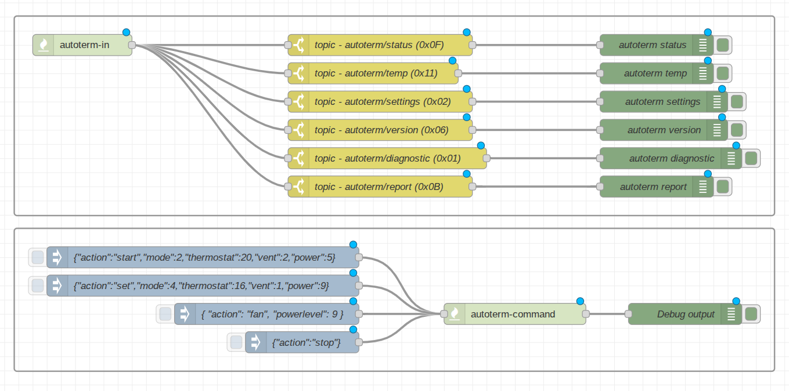
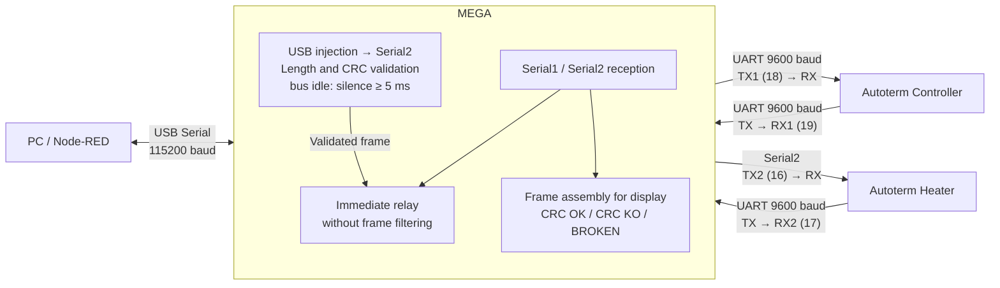

<!-- SPDX-License-Identifier: GPL-2.0-or-later -->
# node-red-contrib-autoterm [](https://www.npmjs.com/package/node-red-contrib-autoterm) [](https://github.com/Capitaine-Adhoc/node-red-contrib-autoterm/actions) [](LICENSE) [](https://www.victronenergy.com/live/venus-os:large)

<p align="center">
  
</p>

## 📋 Description

Node-RED nodes to **monitor and control Autoterm heaters** through an Arduino Mega USB serial proxy.

- Decode live frames: status, temperature, settings, version, diagnostics
- Send commands: start, stop, power, fan, temperature, EEPROM report
- Pure-JavaScript library (CRC, frames, commands, decoders) reusable outside Node-RED

> [!WARNING]
> The protocol comes from **reverse engineering and community efforts**; it is not an official specification. Unrecognized bytes, fields and commands remain raw/unknown rather than being given guessed meanings.

---

## 🚀 Installation

In your Node-RED user directory:

```sh
npm install node-red-contrib-autoterm
```

| Step | Action |
|---|---|
| 1️ | Create one **Autoterm serial** config node and share it among all nodes |
| 2️ | Set the serial path (`/dev/ttyUSB0` or a Windows `COM` port). baud rate defaults to `115200` |
| 3️ | Import `examples/basic-flow.json` and update the serial port |

> [!NOTE]
> The config node opens the port and reconnects automatically.

---

## 🔌 Hardware 

The Arduino proxy board sketch can be found in this dedicated repository : [Capitaine-Adhoc/AutotermProxy](https://github.com/Capitaine-Adhoc/AutotermProxy)



> [!CAUTION]
> Check voltage levels, common ground, wiring and the original heater documentation before connecting. Never connect logic pins directly to an incompatible bus.

---

## 🪢 Nodes

| Node | Role | Details |
|---|---|---|
| **autoterm-serial** | Shared config | Serial path, line parser, reconnect loop, serialized writes. `BUSY` retries the command (default 3), then rejects |
| **autoterm-in** | Receive | Valid CRC-OK frames, optional source/command filter. Includes fuel estimate and mapped state |
| **autoterm-command** | Send command | Takes `{action, ...}` and builds the frame |

**Output of `autoterm-in`:**

| Property | Content |
|---|---|
| `msg.payload` | Decoded object |
| `msg.frame` | Byte array |
| `msg.source` / `msg.cmd` / `msg.type` | Frame metadata |
| `msg.raw` | Raw proxy line |

---

## 🏷️ Topics

| Topic | Content |
|---|---|
| `autoterm/status` | Heater status (state, fuel estimate) |
| `autoterm/temp` | Temperature |
| `autoterm/settings` | Settings |
| `autoterm/version` | Version |
| `autoterm/diagnostic` | Diagnostics |
| `autoterm/report` | EEPROM report |

---

## 🧩 Commands

| Action | Parameters | Description |
|---|---|---|
| `init` | – | Initialize |
| `stop` | – | Stop the heater |
| `status` | – | Request status |
| `getsettings` | – | Read settings |
| `version` | – | Read version |
| `diag` | `enable / disable` | Toggle diagnostics |
| `fan` | `level` | Set fan level |
| `start` / `set` | `mode`, `setpoint`, `fan`, `power` | Start or update |
| `report` | – | Read the heater EEPROM pages |

**Examples of commands :**

```sh
{"action":"start","mode":2,"thermostat":20,"vent":2,"power":5}
{"action":"set","mode":2,"thermostat":20,"vent":2,"power":5}

{"action":"start","mode":4,"thermostat":16,"vent":1,"power":3}
{"action":"set","mode":4,"thermostat":16,"vent":1,"power":3}

{"action":"fan","powerlevel":1}
{"action":"fan","powerlevel":9}

{"action":"diag","enable":true}
{"action":"diag","enable":false}

{"action":"report"}
{"action":"version"}

{"action":"stop"}

```

---

## 🔍 Protocol

| Item | Value |
|---|---|
| Proxy line | `H: AA 03 00 00 0F 58 7C [CRC OK]`, LF-terminated |
| Other lines | `PROXY READY`, `INJ: ...`, `ERR BUSY/CRC/HEX/LENGTH/OVERFLOW`, `[CRC KO]`, `[BROKEN]` |
| Injection | Case-insensitive hex bytes, ending in LF |
| CRC16 | Modbus `0xA001`, init `0xFFFF`, high byte first |

Frame layout:

```
AA | device | payload_len | type | cmd_id | payload... | CRC_hi | CRC_lo
```

**External source:**

- https://grimoire314.wordpress.com/2019/03/21/autoterm-planar-diesel-heater-controller-reverse-engineering-part-2/
- https://schlussdienst.net/html/planar-2d-protocol.md
- https://github.com/tim0816/autoterm_esphome/tree/main
- https://github.com/prclm/AutotermHeaterController

---

## 📚 Library

`lib/` exports pure-JavaScript CRC, frame, command and decoder helpers.

```js
const { buildFrame, parseProxyLine } = require('node-red-contrib-autoterm/lib/frame');
const { TOPICS } = require('node-red-contrib-autoterm/lib/decoders');
```

- State labels and faults follow the original flow
- Consumption estimate assumes a TH11 pump (4.4 ml / 100 pulses)
- EEPROM pages are joined externally, then passed as a 256-byte buffer to `decodeEeprom`
- Unknown values stay labeled *unknown* or raw

---

## 🧪 Development

```sh
npm ci
npm test
```
---

## 📄 License

GPL-2.0-or-later, see [`LICENSE`](LICENSE). Contributions are offered under the same license.
